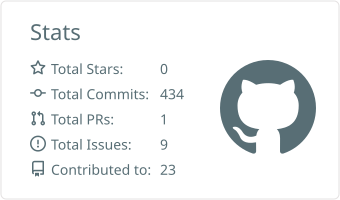
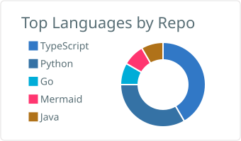
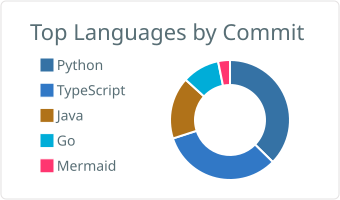

# Hi, I'm Guilherme 👋

*Escolha o idioma / Choose your language*

<!-- ===================== PORTUGUÊS (BR) ===================== -->

<b>🇧🇷 Português (Brasil)</b>

**Índice**

- [👤 Sobre mim](#sobre-pt)
- [🛠️ Tecnologias](#tech-pt)
- [📊 Estatísticas do GitHub](#stats-pt)
- [📬 Entre em contato](#contato-pt)

## 👤 Sobre mim

Engenheiro de software com cerca de 17 anos de mercado e bacharelado em Matemática (UFSC).

- **2011–2015 · P&D em energias renováveis (LABSOLAR, Depto. de Engenharia Mecânica, UFSC):** desenvolvi sistemas embarcados/de aquisição de dados (dataloggers HP e Campbell Scientific, seguidores solares servomecânicos com radiômetros) e rotinas estatísticas (regressão multivariável, EN12975 / ISO9806) para determinar a curva de eficiência de coletores solares planos para aquecimento de água residencial.
- **Desde então · engenheiro full-stack (11 anos):**
  - **Getmore Serviços (2017, hoje Lihai Tecnologia):** primeiro contato com PLN e Aprendizado de Máquina, na deduplicação de dados de produtos coletados via scraping para uma plataforma de e-commerce.
  - **Fundação CERTI / Intelbras (2019–2022):** modelagem e construção de uma plataforma de convergência de dados de dispositivos IoT para segurança patrimonial, sob Scrum.
  - **Strokmatic Automação Industrial / ArcelorMittal Brasil:** plataforma de visão computacional para controle de qualidade de barras de aço no chão de fábrica — câmeras e CLPs, workers em Python, classificadores de defeitos YOLO (PyTorch), buckets no GCP e aplicação cliente em Node.js (Nest.js + Angular.js) com DDD e Clean Architecture sobre PostgreSQL.

Mais detalhes no meu currículo.

## 🛠️ Tecnologias

**Linguagens**

**Frameworks, bibliotecas e runtime**

**Bancos de dados**

**Mensageria e streaming**

**Nuvem e DevOps**

**Arquitetura e padrões de projeto**

**Qualidade e métodos**

**IA / ML, IoT e embarcados**

### 📊 Estatísticas do GitHub

  <picture>
    <source media="(prefers-color-scheme: dark)" srcset="./profile-summary-card-output/github_dark/3-stats.svg">
    
  </picture>
  <picture>
    <source media="(prefers-color-scheme: dark)" srcset="./profile-summary-card-output/github_dark/1-repos-per-language.svg">
    
  </picture>
  <picture>
    <source media="(prefers-color-scheme: dark)" srcset="./profile-summary-card-output/github_dark/2-most-commit-language.svg">
    
  </picture>

## 📬 Entre em contato

<!-- ===================== ENGLISH (UK) ===================== -->

<b>🇬🇧 English (UK)</b>

**Contents**

- [👤 About me](#about-en)
- [🛠️ Technologies](#tech-en)
- [📊 GitHub stats](#stats-en)
- [📬 Contact me](#contact-en)

## 👤 About me

Software engineer with about 17 years in the industry and a degree in Mathematics (UFSC).

- **2011–2015 · R&D in renewable energy (LABSOLAR, Mechanical Engineering Dept., UFSC):** built embedded/data-acquisition systems (HP and Campbell Scientific dataloggers, servomechanical solar trackers with radiometers) and statistical routines (multivariable regression, EN12975 / ISO9806) to determine the efficiency curve of flat-plate solar collectors for residential hot water.
- **Since then · full-stack engineer (11 years):**
  - **Getmore Serviços (2017, today Lihai Tecnologia):** first contact with NLP and Machine Learning, deduplicating scraped product data for an e-commerce platform.
  - **Fundação CERTI / Intelbras (2019–2022):** modelled and built an IoT data-convergence platform for asset security, under Scrum.
  - **Strokmatic Automação Industrial / ArcelorMittal Brasil:** a computer vision platform for steel-bar quality control on the factory floor — cameras and PLCs, Python workers, YOLO (PyTorch) defect classifiers, GCP buckets, and a Node.js client app (Nest.js + Angular.js) built with DDD and Clean Architecture over PostgreSQL.

More details in my CV.

## 🛠️ Technologies

**Languages**

**Frameworks, libraries & runtime**

**Databases**

**Messaging & streaming**

**Cloud & DevOps**

**Architecture & design patterns**

**Quality & methods**

**AI / ML, IoT & embedded**

### 📊 GitHub stats

  <picture>
    <source media="(prefers-color-scheme: dark)" srcset="./profile-summary-card-output/github_dark/3-stats.svg">
    
  </picture>
  <picture>
    <source media="(prefers-color-scheme: dark)" srcset="./profile-summary-card-output/github_dark/1-repos-per-language.svg">
    
  </picture>
  <picture>
    <source media="(prefers-color-scheme: dark)" srcset="./profile-summary-card-output/github_dark/2-most-commit-language.svg">
    
  </picture>

## 📬 Contact me

