## Contents

- [👤 About me](#-about-me)
- [🛠️ Tools that I've worked with so far](#-tools-that-ive-worked-with-so-far)
- [📊 GitHub statistics](#-github-statistics)
- [📬 Other platforms for further contact](#-other-platforms-for-further-contact)

## 👤 About me

Software engineer with about 17 years in the industry and a degree in Mathematics (B.Math UFSC, 2019).

- **2011–2015 · R&D in renewable (solar) energy ([LEPTEN/LABSOLAR](https://lepten.ufsc.br/), [UFSC](https://en.ufsc.br/)):** built embedded/data-acquisition systems (HP and Campbell Scientific dataloggers, servomechanical solar trackers with radiometers) and statistical routines (multivariable regression, EN12975 / ISO9806) to determine the efficiency curve of flat-plate solar collectors for residential hot water consumption.
- **Since then · full-stack engineer (11 years), pending more towards back-end engineering:**
  - **Getmore Serviços (2017, today [LiHai Tecnologia](https://getmore.com.br/)):** first contact with NLP and Machine Learning, deduplicating scraped product data for an e-commerce platform.
  - **[Fundação CERTI](https://certi.org.br/en/) (2019–2020):** Project Guardian (devised by [Intelbras](https://www.intelbras.com/en)) part of the team that designed and built an IoT data-convergence platform for asset security (B2B, B2C), under Scrum.
  - **[Strokmatic Innovation Technology](https://strokmatic.com/):** a computer vision platform for steel-bar quality control on the factory floor ([ArcelorMittal Brasil](https://brasil.arcelormittal.com/)) — cameras and PLCs, Python workers, YOLO (PyTorch) defect classifiers, GCP buckets, and a Node.js client app (Nest.js + Angular.js) built with DDD and Clean Architecture over PostgreSQL.

More details in my CV.

## 🛠️ Tools that I've worked with so far

| Category                 | Technologies                                                                                                                                                                                                                                                                                                                                                                                                                                                                                                                                                                                                                                                                                                                                                                                                                                                                                                                                                  |
| :----------------------- | :------------------------------------------------------------------------------------------------------------------------------------------------------------------------------------------------------------------------------------------------------------------------------------------------------------------------------------------------------------------------------------------------------------------------------------------------------------------------------------------------------------------------------------------------------------------------------------------------------------------------------------------------------------------------------------------------------------------------------------------------------------------------------------------------------------------------------------------------------------------------------------------------------------------------------------------------------------ |
| **Languages**            |                                                                                                                                                                                                                                    |
| **Frameworks & runtime** |          |
| **Databases**            |                                                                                                                                                                                                                                                                                                                                                                                                                                                                                                                                                                                                                                                           |
| **Messaging**            |                                                                                                                                                                                                                                                                                                                                                                                                                                                                                     |
| **Cloud & DevOps**       |                                                                                                                                                                                                                                                                                                                                                                                                                                                                                                              |
| **Architecture**         |                                                                                                                                                                                                                                                                                                                                                                                                                                                                              |
| **Quality & methods**    |                                                                                                                                                                                                                                                                                                                                                                                                                                                                                                                                                                                                                                                                                                                            |
| **AI / ML**              |                                                                                                                                                                                                                                                                                                                                                                                                                                                                                                                        |
| **IoT & embedded**       |                                                                                                                                                                                                                                                                                               |

## 📊 GitHub statistics

  
  

## 📬 Other platforms for further contact

- 
- 
- 
- 

---

[Go back to ToC](#contents)
